# joshuasuzuki.com audit: bugs and UI nits

Audited on Oct 22, 2026 against `joshsuzuki-ae/joshuasuzuki.com` at `794962e` (repo HEAD). The audit itself made no code changes. File references are relative to the repo root.

**34 findings: 4 High, 16 Medium, 14 Low.**

The biggest problems aren't visual:

- **Deploys are broken.** Every deploy since the repo moved to `joshsuzuki-ae` fails at AWS login, so production is frozen at the July 16 build.
- **Link previews are bare.** Shared links have no description or image.
- **The admin login is in the public nav.**

On the app side, RosterLab's flagship Overview has a text overflow bug at every width.

The resume (both the PDF and the resume page) hasn't been updated for the Cursor role yet. The owner knows, so that gap is treated as accepted rather than counted as an issue (see L14).

## How this was tested

- **Production couldn't be loaded from the audit VM.** Its network policy blocks `joshuasuzuki.com`, Cursor's server-side fetch rejects the domain too, and Google's PageSpeed API has no anonymous quota. Instead, I established what production serves from the GitHub Actions history: the last successful deploy is commit `bb1682d`, on Jul 16. I then ran that commit and HEAD side by side on local static servers. Below, "production" means `bb1682d`, and "repo" means HEAD.
- **Browser coverage.** I used Chrome 156 through Playwright, axe-core 4.14, and Lighthouse 12.8, at 1440×900, 768×1024, and 390×844, with both light and dark OS color schemes. I covered 9 pages on both builds (108 page loads), plus scripted interaction tests.
- **Mocks.** Afterglow's weather API (Open-Meteo) is blocked here, so I mocked it with realistic data to exercise the happy path. I also captured the real error state.
- **Contact form.** I intercepted the endpoint. **No test messages were sent to the production inbox.**
- **Admin.** I made read-only requests to the live admin API only, and never tried a login.
- **For a true live pass,** add `joshuasuzuki.com` and `www.joshuasuzuki.com` to the cloud agent's Network Access allowlist. A short manual checklist is at the end.

## Production vs local differences

- **Dark mode exists only in the repo.** `794962e` adds the theme toggle, dark tokens, and `theme-init.js`, but its deploy failed (see H1). Everything else matches. The two builds differ only in `index.html`, `resume/index.html`, `styles.css`, and `theme-init.js`, and RosterLab and Afterglow screenshots are pixel-identical between them.
- **RosterLab API endpoints are injected at deploy time.** `scripts/write-fantasy-config.js` generates them. Locally they're empty, so private-league import is disabled with the caption "Unavailable until the secure relay is deployed". The production values couldn't be confirmed because the run logs have expired.
- **Missing pages and folder URLs behave differently.** The local server serves `/resume/` and shows a plain 404 page. S3 and CloudFront only serve the aliases the deploy creates, and there's no custom error page (see M15).
- **Lighthouse's compression and cache findings are local artifacts.** The local server doesn't compress or set cache headers, so I've left those findings out. CloudFront's behavior is configured outside the repo.
- **CORS differs between the two APIs.** The contact API answers `Access-Control-Allow-Origin: *`, so a local dev run posts to the production inbox. The admin API allows only the two production origins, so admin can't be exercised locally.

## Lighthouse (local server, repo HEAD)

Scores are performance / accessibility / best practices / SEO.

| Page | Mobile | Desktop |
|---|---|---|
| Home | 100 / 100 / 100 / 82 | 100 / 100 / 100 / 82 |
| Resume | 100 / 100 / 100 / 82 | 100 / 100 / 100 / 82 |
| RosterLab (baseball) | **55** / 91 / 96 / 100 | 81 / 91 / 100 / 100 |
| Football calculator | 100 / 100 / 100 / 100 | 100 / 100 / 100 / 100 |
| Afterglow | 99 / 100 / 96 / 91 | 100 / 100 / 96 / 91 |
| Extension privacy policy | 100 / 100 / 100 / 100 | 100 / 100 / 100 / 100 |

A few notes on these numbers:

- **Home and resume lose SEO points** for the missing meta description.
- **The robots.txt audit failure is an artifact.** The pages' CSP meta tag blocks Lighthouse's in-page fetch of `/robots.txt`, and real crawlers aren't affected. The file is still missing (H2).
- **Afterglow's best-practices deduction** comes from the blocked weather API in this environment.
- **The perfect 100s for accessibility don't mean the site is accessible.** Lighthouse doesn't catch the issues in M4 to M6.

---

## High

### H1. Deploys have failed since the repo transfer, so production is three months behind
- **Where:** all pages, all viewports.
- **What's wrong:** The Jul 22 deploy of `794962e` ([run 29938873411](https://github.com/joshsuzuki-ae/joshuasuzuki.com/actions/runs/29938873411)) failed at "Configure AWS credentials (OIDC)" with `Not authorized to perform sts:AssumeRoleWithWebIdentity`. Nothing has shipped since the Jul 16 build (`bb1682d`), so the dark-mode work isn't live. Any fix from this audit won't ship either until this is resolved.
- **Cause:** The deploy role's trust policy only accepts GitHub tokens from the old owner. As of `794962e`, `trust-policy.json:15` allows `repo:jjsuzuki123/joshuasuzuki.com:ref:refs/heads/main`. Since the transfer, GitHub issues this repo immutable OIDC subjects that include the owner and repo IDs: the repo's OIDC settings report `use_immutable_subject: true`. Tokens now carry `repo:joshsuzuki-ae@272345758/joshuasuzuki.com@1121822714:ref:refs/heads/main`, so swapping only the owner name in the policy would still fail.
- **Fix:** Change the `sub` value on the `GitHubActionsDeployPersonalSite` role. Use AWS CloudShell (below), or the console: IAM, Roles, `GitHubActionsDeployPersonalSite`, Trust relationships, Edit. Then re-run the failed deploy (it supports `workflow_dispatch`). The repo copy in `trust-policy.json` has the new value. Consider a failure notification so this doesn't go unnoticed again.

```bash
ROLE=GitHubActionsDeployPersonalSite
aws iam get-role --role-name "$ROLE" --query Role.AssumeRolePolicyDocument --output json > trust-current.json
sed 's#repo:jjsuzuki123/joshuasuzuki.com#repo:joshsuzuki-ae@272345758/joshuasuzuki.com@1121822714#' trust-current.json > trust-new.json
diff trust-current.json trust-new.json   # only the sub line should change
aws iam update-assume-role-policy --role-name "$ROLE" --policy-document file://trust-new.json
```

- **Screenshot:** the production build with OS dark mode (no toggle) next to the repo build. 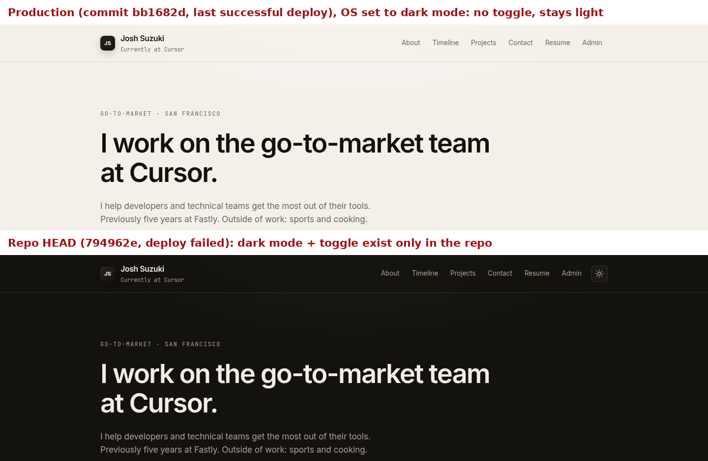

### H2. No link-preview or search metadata on any page
- **Where:** every page (head tags).
- **What's wrong:**
  - The home title is just "Josh Suzuki" (`index.html:10`).
  - Home and resume have no `<meta name="description">`.
  - No page has Open Graph or Twitter Card tags, a share image, or a canonical URL.
  - `robots.txt` and `sitemap.xml` don't exist.
  - Links shared on LinkedIn, Slack, iMessage, or X therefore render as a bare title with no description or image, and Google writes its own snippet.
  - Both `joshuasuzuki.com` and `www.joshuasuzuki.com` point at the CloudFront distribution, and nothing marks which one is canonical.
- **Fix:**
  - Give each page its own title and description, for example "Josh Suzuki | Go-to-market at Cursor".
  - Add `og:title`, `og:description`, `og:url`, and `og:image` (a 1200×630 PNG), plus `twitter:card=summary_large_image`.
  - Add a `<link rel="canonical">` pointing at the primary host.
  - Add `robots.txt` (disallowing `/admin/`) and a `sitemap.xml`.

### H3. "Admin" is a top-level link in the public navigation
- **Where:** Home navigation, all viewports (`index.html:44`). On mobile it sits on the second nav row.
- **What's wrong:** Every visitor sees an "Admin" link next to "Resume", which reads as a hobby project and advertises the login page. The admin page also has no `noindex` tag, so search engines can list it.
- **Auth check:** Admin passed. `GET /admin/messages` with no token, with a bad signature, and with an `alg=none` token all returned `401 {"message":"Unauthorized"}`. Preflights from foreign origins get no `Access-Control-Allow-Origin` header. With an expired token, the UI clears it and returns to login with "Session expired". No data leaked.
- **Fix:** Remove the nav link and bookmark the page instead. Add `<meta name="robots" content="noindex, nofollow">` to `admin/index.html`.

### H4. RosterLab Overview: trade titles overflow their card at every width
- **Where:** `/fantasy/`, Overview, "Trade opportunities" panel. On desktop, the first title runs underneath the "A" grade chip. On mobile at 390px, it runs past the card edge and widens the page to 514px, so the whole app side-scrolls.
- **Cause:** `.mini-opportunity-title` and `.mini-opportunity-reason` are `<span>`s (`fantasy/app.js:892-896`). Their `overflow: hidden`, `text-overflow: ellipsis`, and `white-space: nowrap` rules (`fantasy/styles.css:1051-1069`) don't apply to inline elements. The same cause makes the reason text ("Adds K.") flow onto the title line when a title is short.
- **Fix:** Add `display: block` to both classes, or render them as `<p>` or `<div>`. Optionally allow two lines with `-webkit-line-clamp: 2`.
- **Screenshots:** 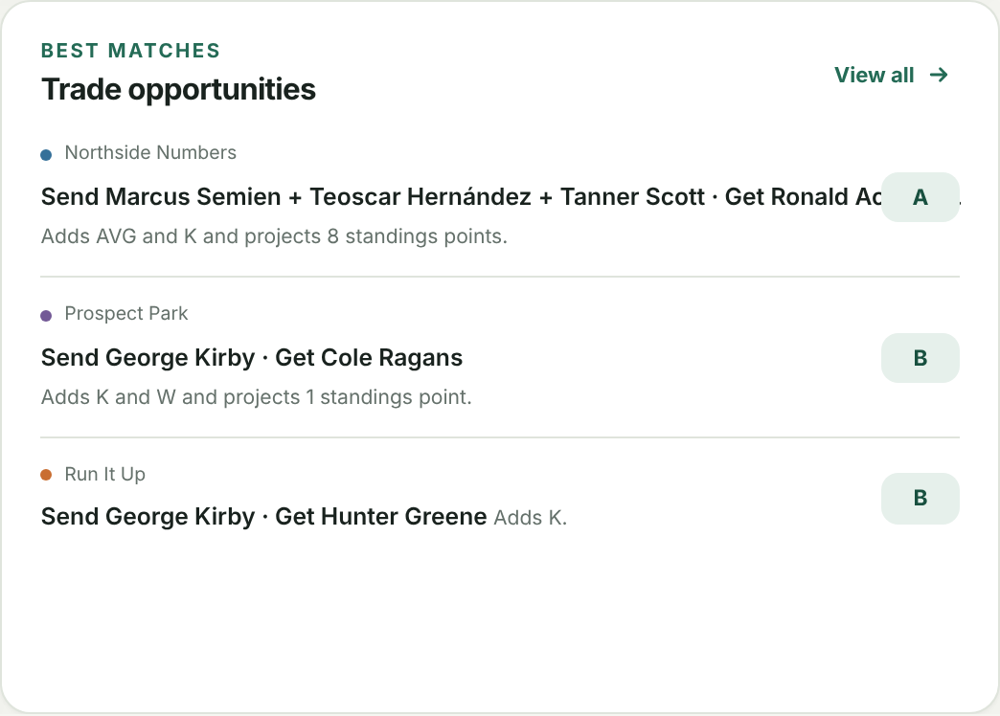 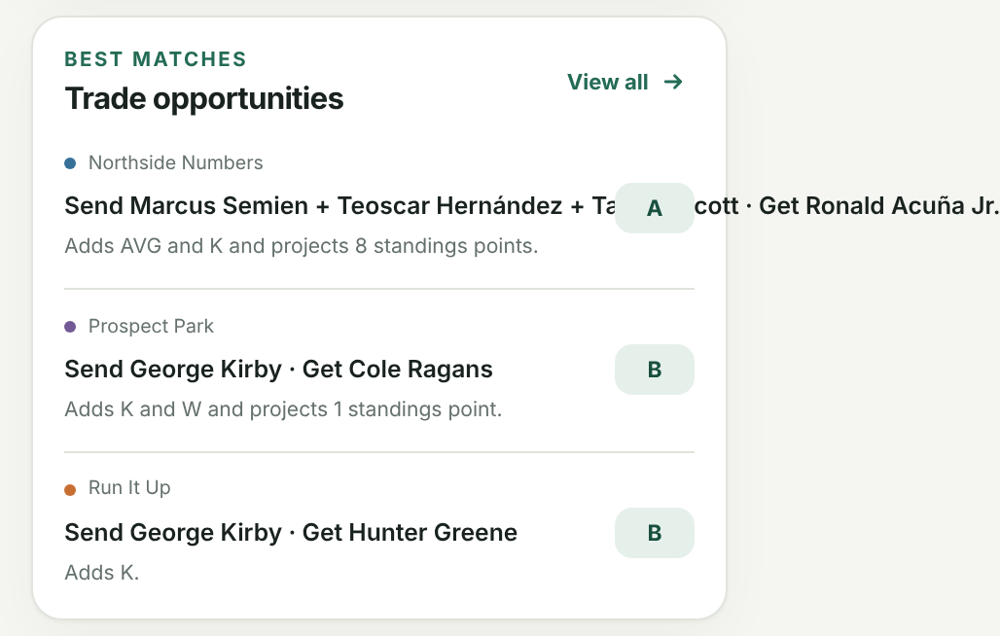

---

## Medium

### M1. `/resume.pdf` is a corrupted, blank PDF at the most guessable resume URL
- **Where:** `https://joshuasuzuki.com/resume.pdf`. It's deployed but not linked anywhere.
- **What's wrong:** The file contains 39,091 Unicode replacement characters, and all 16 of its compressed streams fail to decode, so it renders as a blank page. It was corrupted when committed in the initial commit (`ab9ea46`), apparently by being saved as text.
- **Fix:** Delete it, or replace it with the current PDF and make `/resume.pdf` the canonical resume URL.

### M2. Favicons are white on transparent, and only the home page declares any
- **Where:** browser tabs and bookmarks for every page except home; iOS home-screen and share sheets.
- **What's wrong:** `favicon.ico` (16 to 64px), `favicon-32.png`, and `apple-touch-icon.png` are a white "JS" on a fully transparent background, so they vanish on light tab strips and light iOS surfaces. Only `transparent-favicon.svg` has a solid tile, and only `index.html:14-17` links any icon, so the other pages fall back to the invisible `/favicon.ico`. The SVG's navy `#1e2940` tile also doesn't match the site's warm black and eggshell palette.
- **Fix:** Regenerate the ICO and PNGs with a solid background in the brand color. Add the same icon links, plus a web manifest, to every page.
- **Screenshot:** 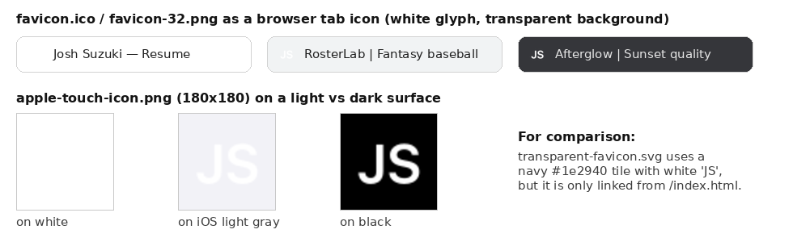

### M3. Resume header doesn't match the home header and breaks on mobile
- **Where:** Resume, all viewports; worst at 390px.
- **What's wrong:** There's no "JS" mark, and the name and tagline sit side by side instead of stacked. On mobile, "Josh Suzuki" wraps onto two lines beside a two-line tagline. The page has no "Resume" heading; it opens with roughly 110px of empty space before the small "SUMMARY" label.
- **Cause:** `resume/index.html:27-32` omits the `.mark` span and the inner wrapper `div` that `index.html:31-37` uses, and `.branding` is a flex row. The `main` top padding (3rem) and `.section` top margin (6rem) stack up.
- **Fix:** Share one header across pages. Add an h1 "Resume" with a primary "Download PDF" button, and trim the first section's top margin.
- **Screenshots:** 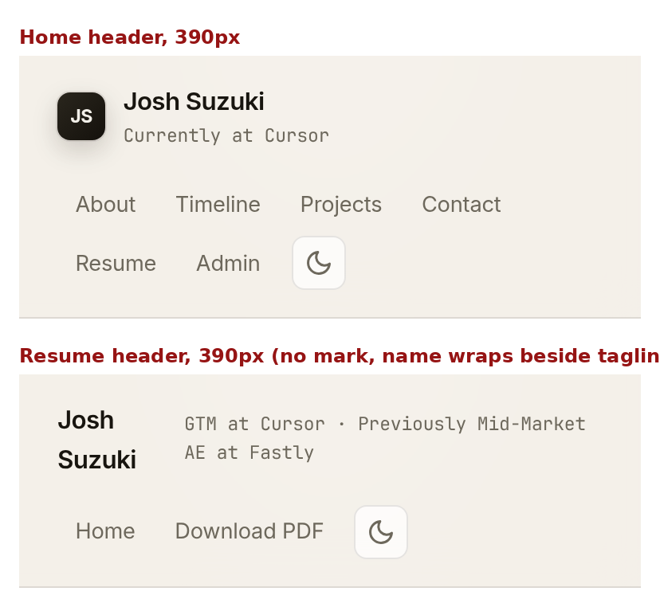 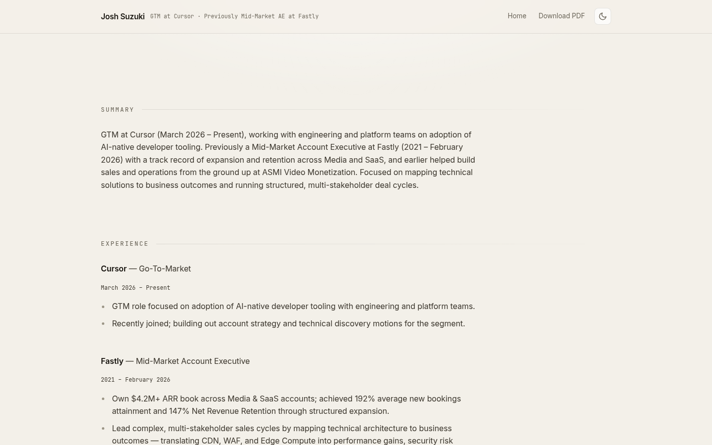

### M4. The resume's "Download the PDF version here." link looks like plain text
- **Where:** Resume, "Resume (PDF)" section, all viewports.
- **What's wrong:** The link has exactly the same color as the surrounding text and no underline, so it isn't recognizable as a link, which fails WCAG 1.4.1. The link text "here" is also vague.
- **Cause:** The global `a { color: inherit; text-decoration: none; }` (`styles.css:126-129`), with no link style for body content.
- **Fix:** Add a link style for body content (an underline with offset, or an accent color), and turn the PDF download into a visible button.
- **Screenshot:** 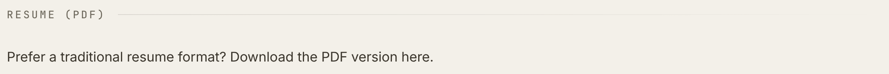

### M5. Contact form accepts bad emails and doesn't announce its status
- **Where:** Home, Contact section, all viewports.
- **What's wrong:**
  - `novalidate` (`index.html:285`) turns off the browser's email check, and `script.js:45-48` only checks that fields aren't empty. In testing, "not-an-email" was submitted and the form said "Message sent." I mocked the endpoint; whether the contact Lambda rejects bad emails is unknown, because its code isn't in the repo.
  - The status line (`index.html:305`) has no `role="status"` or `aria-live`, so screen-reader users never hear "Sending...", "Message sent.", or errors.
  - An empty submit shows one generic message, with no field highlighting and no focus move.
  - Typed text renders in monospace, because the inputs sit inside the monospace labels and use `font-family: inherit` (`styles.css:676-685`, `:697`).
- **Fix:** Validate the email (remove `novalidate`, or call `checkValidity()`). Add `role="status"` to `#contact-status`, set `aria-invalid` on bad fields, and focus the first one. Give inputs the body font.
- **Screenshot:** 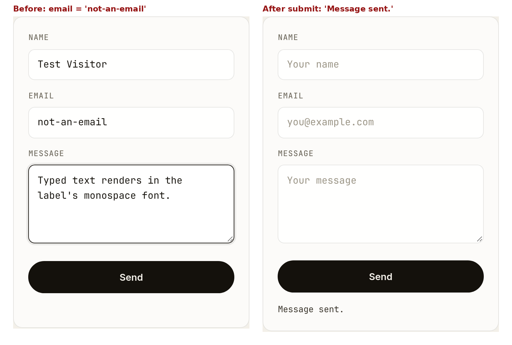

### M6. The "Time at Cursor" ticker is a live region that updates every second
- **Where:** Home, Timeline, Cursor card.
- **What's wrong:** `index.html:202` puts `aria-live="polite"` on an element that `script.js:104-136` rewrites every second, so screen readers keep re-announcing it. Visually, a seconds counter ("233 days, 8 hours, 36 minutes, 17 seconds") reads as a gimmick on a professional page.
- **Fix:** Drop `aria-live`, and the `aria-label` on the `<p>`. Show "Since March 2026" or a month count, updated once per load.

### M7. The header was built to stick but doesn't, and mobile has no menu
- **Where:** Home and Resume. The stickiness issue affects all viewports; the nav layout affects 390px and 768px.
- **What's wrong:**
  - `header` is styled as a sticky, blurred bar (`styles.css:145-153`), but a later `header, main, footer { position: relative; z-index: 2; }` rule (`styles.css:764-769`) overrides it. The header scrolls away and the blur effect never shows.
  - On mobile, the nav wraps into two rows under the brand, making the header 165px tall, with no menu button.
  - At 768px the header also stacks, although the nav fits on one line (`styles.css:814-824`).
- **Fix:** Decide whether the header should stick. If so, exclude `header` from the later rule and add a compact mobile header with a menu button, so it doesn't take up 20% of the screen.
- **Screenshot:** 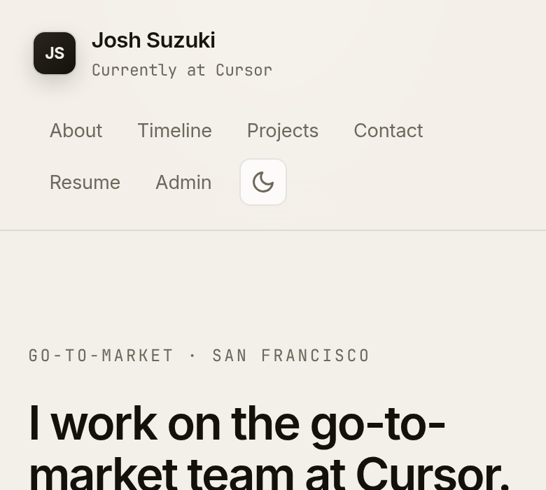

### M8. All project cards act clickable, but only two are links
- **Where:** Home, Projects, at desktop and tablet (anywhere hover exists).
- **What's wrong:**
  - `.card:hover` (`styles.css:612-616`) lifts every card. Only RosterLab and Afterglow are links (`index.html:224`, `:233`).
  - "This Website", "GTM Automations", and "Infra & Performance Lab" are `<article>`s with nothing to open.
  - Nothing visually distinguishes the two clickable cards.
  - Five cards in a three-column grid leave an empty slot.
- **Fix:** Apply the hover effect only to `.card-link`, and add an arrow or "Open" cue. Either link the other three cards (repo, write-up, demo) or cut them.
- **Screenshot:** "This Website" (not a link) in its hover state. 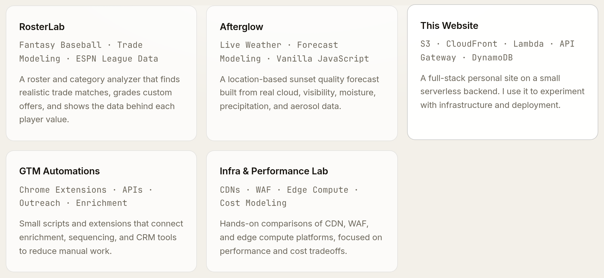

### M9. Fonts are inconsistent across pages, and the font file blocks rendering
- **Where:** all pages.
- **What's wrong:**
  - Home loads Inter.
  - Resume (`resume/index.html:15`) and the AI simulator load Geist and Geist Mono, but `styles.css` asks for Inter, so Geist goes unused and the resume renders in each visitor's system font.
  - Admin uses Geist.
  - RosterLab, Football, and Afterglow name Inter but never load it.
  - Visitors therefore see at least three different body typefaces.
  - The Google Fonts stylesheet blocks rendering. Lighthouse estimates about 0.6 to 0.8s of delay on mobile for the home page.
- **Fix:** Use one type system. Self-host one variable WOFF2 font, preload it with `font-display: swap`, use it on every page, and remove the unused Geist requests.

### M10. RosterLab Player market overflows on tablet and hides key columns on mobile
- **Where:** `/fantasy/#market` at 768px and 390px.
- **What's wrong:**
  - At 768px, the sidebar stays open and leaves the workspace only 536px wide. The "Sort" select runs off-screen (to x=837), and the watchlist star column is cut in half at the card edge.
  - At 390px, the table scrolls inside its card, but the most important column, "Model value", starts off-screen with no scroll cue.
- **Cause:** The market toolbar doesn't wrap. `.market-table-shell` uses `overflow: hidden` (`fantasy/styles.css:2234-2240`) with `table-layout: fixed`. The sidebar only collapses below 760px.
- **Fix:** Let the toolbar wrap, and make the sidebar off-canvas below about 1024px. On narrow screens, show rows as cards or pin the value column.
- **Screenshot:** 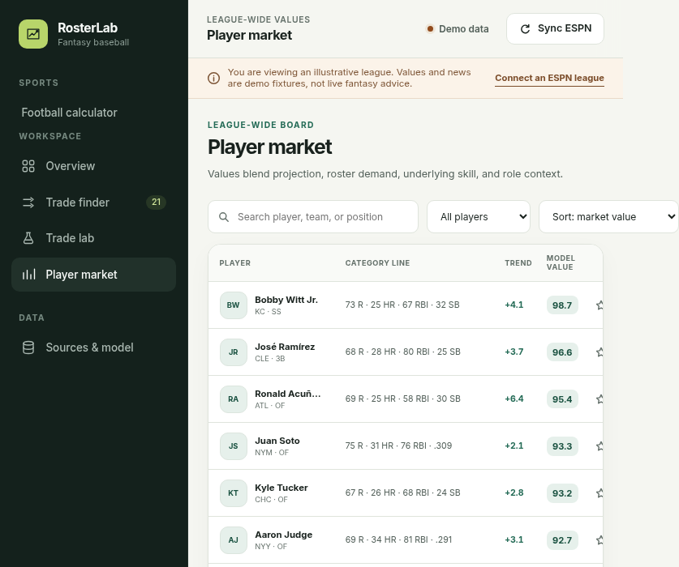

### M11. RosterLab is slow on mobile
- **Where:** `/fantasy/` on mobile; desktop is milder.
- **What's wrong:** Lighthouse scores mobile performance 55 (desktop 81). Total blocking time is 1,760ms, largest contentful paint is 5.0s, and JavaScript execution takes 3.5s. About 275 KB of unminified JavaScript runs on load (`app.js` 104 KB, `trade-engine.js` 78 KB, `espn-client.js` 41 KB, `source-client.js` 35 KB), including the demo league's trade search. Lighthouse also finds only 47% of the text at legible sizes on mobile (see M12).
- **Fix:** Minify and bundle the scripts. Run the trade search after first paint (idle callback or Web Worker), and load the ESPN and source clients only when the user connects a league.

### M12. Accessibility failures in the apps
axe-core found these on the repo build; they're identical in production.

- **RosterLab:**
  - 10 `aria-label`s on plain `div`s, which screen readers ignore.
  - 4 contrast failures (2.9 to 3.4:1) on "punted category" text.
  - About 60 text elements below 11px on the Overview, down to 8.6px (for example, `.category-inference` at 0.54rem, `fantasy/styles.css:994-999`).
  - The brand link's accessible name, "RosterLab home", doesn't include its visible text.
- **Football:** The rankings table scrolls on mobile but can't be reached by keyboard (`.table-wrap`).
- **Afterglow:** Seven day-card buttons have `aria-label`s that don't contain their visible text, which breaks voice control.
- **AI simulator:** Nine range sliders have no associated label (`aisimulator/index.html:66-91`).
- **Fix:**
  - Give labelled divs a role, or show the text.
  - Set a 12px minimum text size and use AA-contrast grays.
  - Add `tabindex="0"` and a label to scroll containers.
  - Start each `aria-label` with the visible text.
  - Wrap each slider in its `<label>`, or use `for=`.
- **Screenshot:** 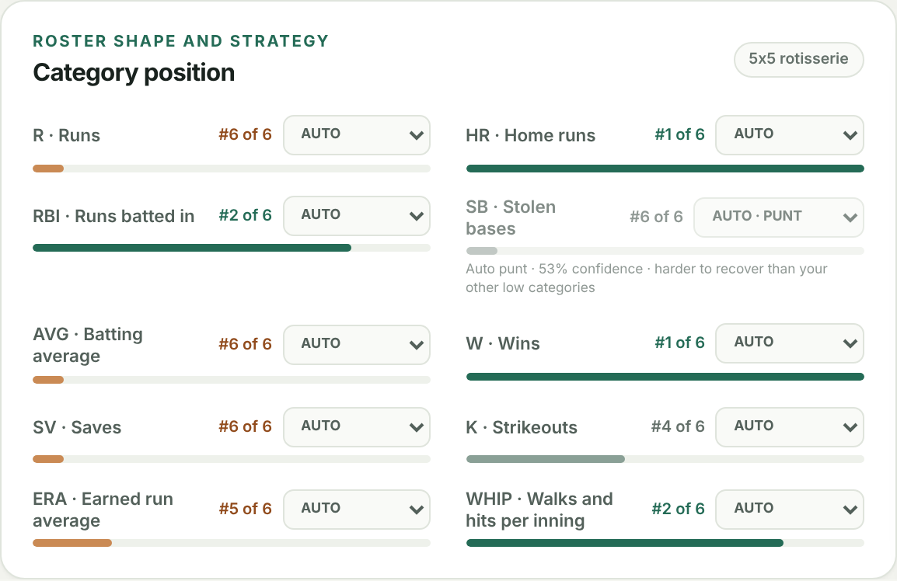

### M13. Unfinished and stray files are publicly deployed
- **Where:** production URLs that nothing links to.
- **What's wrong:** The deploy syncs the whole repo root with only a few excludes (`deploy.yml:195-216`), so these are public:
  - `/aisimulator/`. Its default values open it in a broken state, "P95 Latency: ∞" with "UNSTABLE: demand exceeds capacity". It has no link back to the site, browser-default blue sliders, and leftover AI-assistant comments in its source ("cursor glow", "absolute paths per your rules", `aisimulator/index.html:17,51`).
  - `/top5artists.json`: "sample data for joshuasuzuki.com /music page", a page that doesn't exist.
  - `/README.md`, `/.gitignore`, `/fantasy/README.md`, and `/sunset/README.md`.
  - `/personal-site-logo.png` (108 KB, unused).
  - `/resume.pdf` (see M1).
- **Fix:** Deploy from an explicit public folder, or add excludes. Finish and link the simulator, or remove it.
- **Screenshot:** 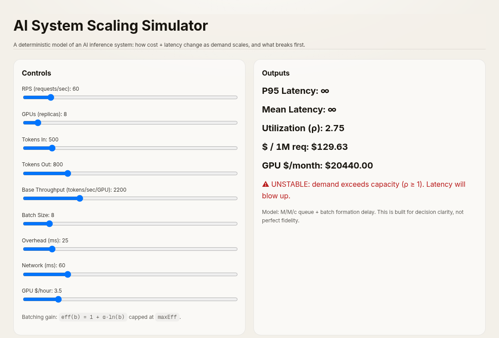

### M14. Afterglow's hero headline cuts off the "g" in "chasing"
- **Where:** `/sunset/`, all viewports, first screen.
- **What's wrong:** The italic gradient "worth chasing." loses its "g" descender, so it reads like "chasinq".
- **Cause:** `sunset/styles.css:247` sets `line-height: 0.88`, and the `em` paints its gradient with `background-clip: text` (`:250-256`). The gradient box ends above the descender.
- **Fix:** Add `padding-bottom: 0.15em` with a matching negative `margin-bottom` to the `em`, or give it `line-height: 1`.
- **Screenshot:** 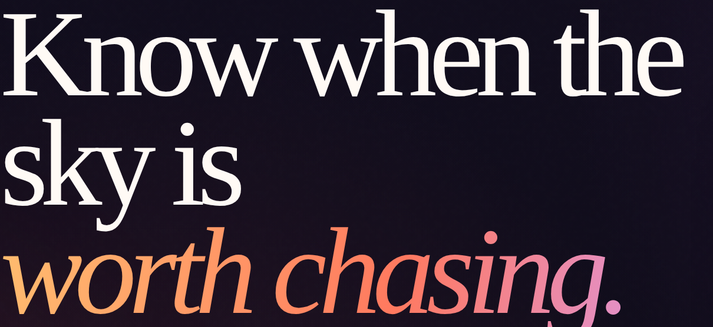

### M15. No 404 page, and folder-style URLs probably fail in production
- **Where:** any missing URL, plus `/resume/`, `/resume`, and `/admin/` (unverified in production).
- **What's wrong:** The repo has no 404 page, and the deploy configures no error responses. Behind S3 and CloudFront, a missing page usually returns a raw XML "AccessDenied" or "NoSuchKey" document. The deploy only creates folder aliases for `/sunset`, `/fantasy`, and `/fantasy/football` (`deploy.yml:281-307`), so `/resume/` likely errors in production even though it works locally.
- **Fix:** Add a styled `404.html` and configure CloudFront custom error responses for 403 and 404. Add a CloudFront Function that rewrites `/path/` to `/path/index.html`, then drop the per-app alias uploads.

### M16. The home timeline and the resume page disagree on career facts
- **Where:** Home (Timeline) and Resume, all viewports.
- **What's wrong:** These conflicts are separate from the pending Cursor update (L14).

| Fact | Home timeline | Resume page |
|---|---|---|
| Transfer to USC | "Transferred Fall 2018" (`index.html:169`) | "Transferred ... Spring 2018" (`resume/index.html:127`); the PDF also says spring |
| Fastly title | SDR 2021–22, SMB AE 2022–23, Mid-Market AE 2023–26 (`index.html:184-186`) | "Mid-Market Account Executive, 2021 – February 2026" (`resume/index.html:92-93`) |
| ASMI Video Monetization (2020–21) | missing | listed |

- **Fix:** Make the two pages agree. Both resumes say Spring 2018, so the timeline's "Fall 2018" is probably the one to change. Either show the Fastly promotions on the resume page, or use one title on both.

---

## Low

- **L1. Uneven content widths and dead space (Home, desktop).**
  - About, Timeline, and Contact are capped at 760px (`styles.css:310-313`), while Projects spans 1080px (`styles.css:594-599`). The right edge jumps between sections and leaves a wide empty column at 1440px.
  - There's about 176px of empty space above the footer (5rem `main` bottom padding plus a 6rem footer top margin).
  - The resume uses `<br />` tags as spacers (`resume/index.html:90,104`).
  - Fix: use one content width and margin-based spacing. 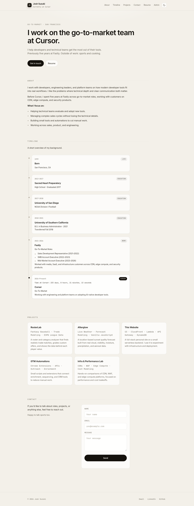
- **L2. The card meta line never gets its faint color.** `.card p` and `.section-body p` outrank `.card-meta` (`styles.css:634-646`), so the meta line has the same color as the description, and its margin needed `!important`. Fix: use a `.card .card-meta` selector and drop `!important`.
- **L3. Timeline content.**
  - The Cursor card is tagged "CURSOR" instead of "WORK" (`index.html:200`), and the ticking timer sits above the card title.
  - "Born 1999" and high school read as filler on a professional timeline.
  - Capitalization is inconsistent: "Go-To-Market" (`index.html:69,182,207`) versus "go-to-market" in the hero.
  - 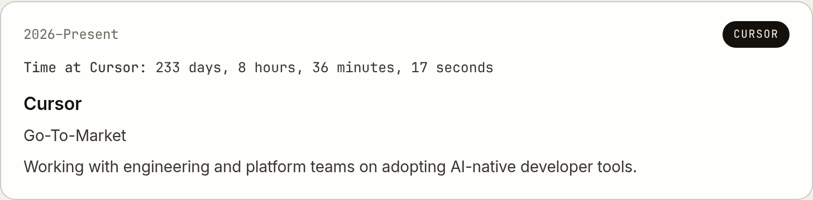
- **L4. Mobile alignment and wrapping (390px).**
  - Nav and footer links are inset about 12px from the brand and copyright, because the links' padding has no compensating negative margin.
  - The hero breaks "go-to-" / "market" across lines.
  - Timeline bullets break inside date ranges, as in "(2023–" / "2026)".
  - Fix: add a negative margin to the link rows, use `white-space: nowrap` on date ranges, and use non-breaking hyphens (U+2011).
- **L5. Dark mode gaps (repo only).** Only home and resume honor the theme; the other five pages ignore the saved choice. The "JS" mark keeps a hard-coded near-black gradient (`styles.css:171-183`) and nearly disappears on the dark header. 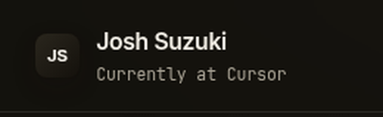
- **L6. Risk of stale CSS after the next deploy.** `styles.css`, `script.js`, and `theme-init.js` have no version query string, unlike the apps' `?v=` URLs. The deploy sets no Cache-Control on CSS and JS while HTML is no-cache (`deploy.yml:248-272`). Returning visitors could get new HTML with an old cached stylesheet, for example an unstyled theme toggle. Fix: version the main assets and give versioned files a long max-age.
- **L7. Home semantics.**
  - There's no skip link (the apps have one).
  - The hero headline is an h2, while the h1 is the small name in the header (`index.html:34,70`).
  - The copyright year is filled in by JavaScript, so it's empty without JS.
  - Fix: make the hero the h1, add a skip link, and write the year at deploy time.
- **L8. RosterLab copy.**
  - The hero says "Home runs is your bankable strength": the `${strength.name} is` template at `fantasy/app.js:1034` breaks on plural categories. 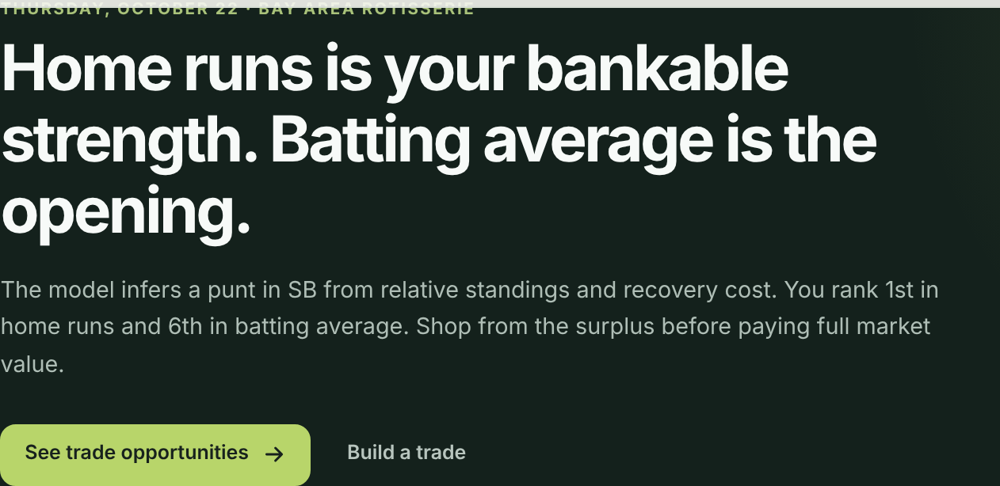
  - The import dialog shows every visitor a "Research access code: Required only for new Firecrawl research" field (`fantasy/index.html:660-674`). It names an internal vendor and asks for a code the public doesn't have.
  - Check that production doesn't show "Unavailable until the secure relay is deployed" (`fantasy/app.js:2265`).
  - The sidebar's "Football calculator" item has no icon and crowds the "WORKSPACE" label.
- **L9. Football calculator polish.**
  - Copy reads "pays a roster-space tax for +1 player(s)." (`fantasy/football-trade.js:130,140`).
  - Values print with inconsistent precision ("45" next to "43.8").
  - There's no link back to joshuasuzuki.com, only Football and Baseball tabs.
  - Its "RL" logo and layout differ from the baseball app's.
- **L10. Afterglow typography.**
  - The formula header's `text-transform: uppercase` (`sunset/styles.css:1075-1084`) turns the exponents α, β, γ into A, B, Γ, so the formula's meaning changes. 
  - Headings use system Georgia or Times at -0.065em letter-spacing, so letters touch on Windows and Linux.
- **L11. Admin flash.** With an expired token, the empty "0 entries / Loading entries..." table flashes before the 401 returns the page to login (`admin.js:267-273`). Fix: show a neutral loading state first.
- **L12. Profiles.**
  - The GitHub link points to `github.com/jjsuzuki123`. It resolves, but the profile has no name or bio, and the site's own repo now lives under `joshsuzuki-ae`.
  - The LinkedIn, ESPN, FanGraphs, RotoWire, Baseball Savant, and Open-Meteo links couldn't be checked from this VM.
- **L13. Resume copy nits.**
  - "JIRA" should be "Jira" (`resume/index.html:111,142`).
  - A whole "Resume (PDF)" section holds a single sentence.
- **L14. Resume PDF file polish (content update pending).**
  - The resume hasn't been updated for the Cursor role yet, so this isn't counted as an issue. The PDF still lists "Fastly, July 2021-Present" and New York, while the resume page says "Recently joined" (`resume/index.html:87`) and keeps present-tense Fastly bullets (`resume/index.html:95-101`). It's listed here so the update covers it.
  - Separate from the content, the file has three problems:
    - The file name has spaces and a `.docx.pdf` double extension.
    - The browser tab shows the PDF's internal title "AE Resume - 2026.docx".
    - The PDF publishes a personal phone number.
  - Fix, when the resume is updated:
    - Publish it under a clean name such as `/josh-suzuki-resume.pdf`, also served at `/resume.pdf` (see M1).
    - Set the PDF's Title metadata.
    - Decide whether the phone number belongs on a public URL.
  - 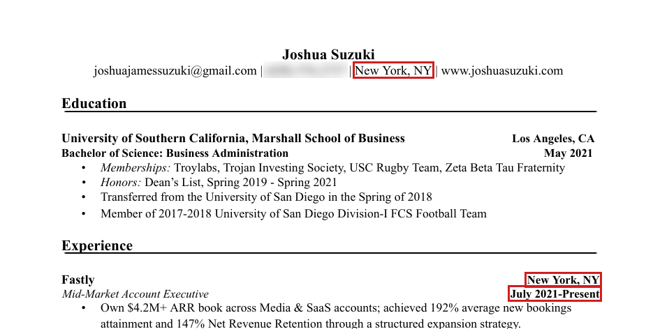

---

## Not verifiable from here (2-minute manual check)

These depend on CloudFront settings that live outside the repo:

```bash
curl -sI http://joshuasuzuki.com/ | head -3              # expect 301 to https
curl -sI https://www.joshuasuzuki.com/ | head -3         # expect 301 to the canonical host (or the reverse)
curl -sI https://joshuasuzuki.com/ | grep -i -E "strict-transport|content-encoding|x-frame|content-security"
curl -sI https://joshuasuzuki.com/does-not-exist | head -3   # expect a 404 with a styled page
curl -sI https://joshuasuzuki.com/resume/ | head -3          # expect 200, or a redirect to /resume/index.html
curl -s https://joshuasuzuki.com/fantasy/config.js           # confirm the RosterLab relay endpoints are set
```

---

## Why the site feels generic

This is input for the redesign.

- **It follows the stock portfolio template:** header, an "I work on X at Y" hero, About bullets, a vertical timeline of cards, a three-column grid of project cards, a contact form, and a footer. Every section is text in the same rounded, translucent card with a 1px border and a 14px radius.
- **There are no images at all:** no photo, no product screenshots, no logos. The two apps worth showing off, RosterLab and Afterglow, are visually rich, yet the home page presents them as two plain text cards. 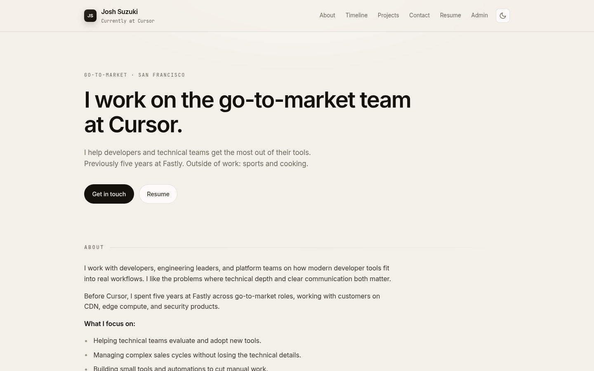
- **It has no identity color.** The palette is a borrowed "Cursor eggshell" theme (the comment at `styles.css:6`) with black as the only accent. The apps have stronger identities (RosterLab's charcoal and green, Afterglow's sunset gradient) than the personal site.
- **The copy is safe and unquantified.** Lines like "I help developers and technical teams get the most out of their tools" and "I like the problems where technical depth and clear communication both matter" could belong to anyone. The resume's strongest proof never reaches the home page: a $4.2M ARR book, 192% bookings attainment, 147% NRR, and employee #3 at a startup.
- **The type is the default dev-portfolio look:** Inter, plus tiny uppercase monospace labels with wide letter-spacing (ABOUT, TIMELINE, and so on). After the hero there's no typographic anchor, and the section headers are small gray captions.
- **The distinctive story is buried.** A go-to-market person who ships real software, a Division I football player, and a CDN and edge specialist all sit under filler ("Born 1999", high school) and gimmicks (the seconds ticker).
- **The "JS" monogram is generic,** and technical visitors will read "JS" as JavaScript.
